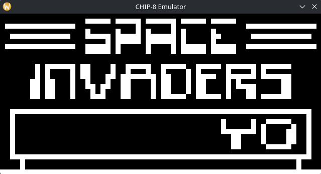
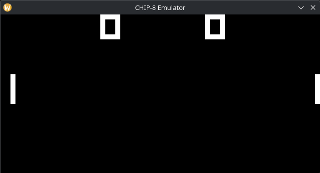

## Chip-8-Emulator

A CHIP-8 emulator in C++



Space Invaders



Pong

CHIP-8 is an interpreted programming language developed by Joseph Weisbecker in the mid 70s and was initially used on the COSMAC VIP and Telmac 1800 8-bit microcomputers to make game programming easier. CHIP-8 programs are run using a CHIP-8 virtual machine.

This is a complete implementation of the CHIP-8 virtual machine.

## Compiling and Running

### Requirements

- A C++17 compiler (GCC, Clang or MSVC)
- CMake 3.16 or newer
- SDL3 development files (e.g. `sudo dnf install SDL3-devel` on Fedora)

### Building

```
cmake -B build
cmake --build build
```

This produces the `build/chip8` executable.

### Running

```
./build/chip8 <Scale> <Delay> <ROM>
```

- `Scale` - window size multiplier; `10` gives a 640x320 window
- `Delay` - milliseconds between CPU instructions; lower is faster. `1` (about 900 instructions per second) suits most games
- `ROM` - path to a CHIP-8 ROM file

Game ROMs are not included in this repo. Download them from [kripod/chip8-roms](https://github.com/kripod/chip8-roms) into a `games/` folder (ignored by git).

Example (the quotes are needed because the file name contains spaces):

```
./build/chip8 10 1 "games/Space Invaders [David Winter].ch8"
```

### Controls

The CHIP-8's 16-key hex keypad is mapped to the left side of the keyboard. Esc quits.

```
Keyboard     CHIP-8 keypad
1 2 3 4      1 2 3 C
Q W E R      4 5 6 D
A S D F      7 8 9 E
Z X C V      A 0 B F
```

Each game chooses its own keys. Many ROMs in `games/` come with a `.txt` file that describes the controls using CHIP-8 key names; use the table above to translate them. For example, Space Invaders moves with 4 and 6 and shoots with 5, which are `Q`, `E` and `W` on the keyboard.

### Testing

The emulator was tested with [Timendus' CHIP-8 test suite](https://github.com/Timendus/chip8-test-suite). To run it yourself, download the `.ch8` files from the suite's `bin/` folder into `test/` (ignored by git), then run one, for example:

```
./build/chip8 10 1 test/3-corax+.ch8
```

All tests pass, except that the quirks test marks three behaviours as different from the original COSMAC VIP (`VF reset`, `Memory` and `Display wait`). These are deliberate: this emulator follows the behaviour of later CHIP-8 interpreters instead.

## References
Guides and Resources I used when writing this

- https://tobiasvl.github.io/blog/write-a-chip-8-emulator/
- https://austinmorlan.com/posts/chip8_emulator/
- https://github.com/Timendus/chip8-test-suite (used for testing)
- https://github.com/kripod/chip8-roms (source of the game ROMs in `games/`)
